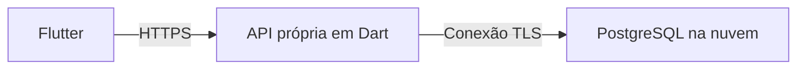

# Achados e Perdidos: planejamento de desenvolvimento da equipe

## Referências, prazo e premissas

- Fonte de verdade para o comportamento da aplicação: [enunciado oficial](pmob-aval2.pdf).
- Ampliação solicitada: incluir cadastro de usuários e autenticação, além do
  cadastro de objetos. Essa ampliação não é exigida pelo PDF e não altera os
  critérios de pontuação nem o prazo oficial.
- Decisão de autenticação: implementar uma API própria de cadastro, entrada e
  sessões. Não utilizar Supabase Auth. O Supabase permanece apenas como opção de
  hospedagem do PostgreSQL, substituível sem alterar os contratos do aplicativo.
- Convenções de engenharia: [AGENTS.md](../AGENTS.md).
- Período do planejamento: de 27 de outubro a 8 de novembro de 2026.
- Prazo oficial: **08/11/2026, às 23h59**, com entrega exclusivamente pelo
  SIGAA, contendo o endereço do repositório público no GitHub e o nome completo
  de todos os integrantes (seção 8 do enunciado).
- Meta interna de entrega: **08/11, às 20h**. Utilizar o fuso
  America/Fortaleza no cronograma da equipe e confirmar o prazo no SIGAA.
- Equipe: **Fabricio, Francisco, Ruan e Willamy**. Ruan e Willamy são considerados
  integrantes distintos. Ainda é necessário reunir os nomes completos e as contas
  do GitHub.
- Situação atual: existem os requisitos e as instruções para agentes; ainda não há
  aplicação Flutter, manifesto de dependências ou serviço de nuvem configurado.
  O Git foi inicializado, e a documentação está publicada no repositório público
  [Fabricio-Fontenele/aval2-pmob](https://github.com/Fabricio-Fontenele/aval2-pmob),
  com a branch principal `main`.
- As datas são marcos propostos, sem pressupor a disponibilidade individual.
  Confirmar a disponibilidade na reunião inicial e redistribuir tarefas quando
  necessário, preservando o tempo reservado à integração e à verificação final.

Este documento planeja trabalho futuro. Ele não provisiona serviços, inicializa
o Git, cria código da aplicação nem autoriza agentes a executar commits, enviar
alterações ao remoto, publicar o projeto ou realizar a entrega.

## Entrega e escopo

Entregar um aplicativo móvel executável com quatro telas: listagem de objetos,
cadastro de objetos, entrada e cadastro de usuários. Os registros devem ser
compartilhados remotamente entre instalações e continuar disponíveis após o
encerramento do aplicativo. Utilizar objetos e contas demonstrativas, com
endereços de e-mail de teste e senhas exclusivas, sem informações pessoais reais.

| Critério de avaliação | Pontos | Evidência necessária | Responsáveis principais |
| --- | --- | --- | --- |
| Cadastro e validação | 2,0 | Campos obrigatórios; nome com até 60 caracteres; descrição com até 200 caracteres; local e situação; registro automático de data e hora | Willamy nos formulários e validações; Francisco na validação dos objetos na API |
| Listagem e apresentação dos registros | 2,0 | Nome, local, situação e descrição; diferenciação entre perdido e encontrado; mais recentes primeiro; atualização manual | Ruan |
| Integração com armazenamento em nuvem | 2,0 | Leituras e gravações remotas reais; persistência após reiniciar; compartilhamento entre instalações; serviço gratuito funcionando | Francisco |
| Assincronismo e gerenciamento de estado | 2,0 | Carregamento, sucesso, falha, nova tentativa, proteção contra envios repetidos e atualização da lista após o cadastro | Ruan integra o fluxo; cada autor cuida dos estados e das operações do seu módulo |
| Interface, qualidade do código e organização do repositório | 2,0 | Material 3; interface em português; disposição responsiva; código formatado e sem problemas no analisador; repositório público e README completos | Willamy consolida o aceite e o README; cada integrante verifica e documenta sua entrega |

Os cinco critérios têm o mesmo peso. Concluir o fluxo obrigatório completo antes
do refinamento visual. O cadastro de usuários e a autenticação passam a integrar
o escopo adicional solicitado, sem acrescentar pontuação à tabela oficial.
Edição, exclusão, fotos, notificações, pesquisa avançada e recursos nativos do
dispositivo continuam fora deste plano.

### Cadastro de usuários e autenticação

Os identificadores AU01-AU05 abaixo pertencem a este planejamento e não são
requisitos numerados pelo enunciado.

| ID | Comportamento planejado | Critério de aceite |
| --- | --- | --- |
| AU01 | Cadastro de usuário por e-mail e senha | E-mail obrigatório em formato válido e único após normalização; senha com pelo menos 8 caracteres, validada também pela API; confirmação de senha idêntica; carregamento, erro compreensível e proteção contra envio repetido |
| AU02 | Entrada por e-mail e senha | Campos obrigatórios; verificação real das credenciais pela API própria; credenciais inválidas não abrem a sessão; falhas de comunicação permitem nova tentativa |
| AU03 | Sessão e saída | Recuperar o token armazenado com segurança e validar a sessão na API ao iniciar; tratar expiração e revogação; saída bem-sucedida invalida a sessão no servidor e remove o token local |
| AU04 | Autorização de publicação | Listagem e atualização permanecem públicas; cadastrar objetos exige sessão válida; o servidor rejeita inserções sem autenticação ou com autoria diferente do usuário autenticado |
| AU05 | Navegação e avaliação | Acesso às telas de entrada e criação de conta pela listagem; após entrar, retornar ao cadastro de objeto solicitado; cancelamento e saída mantêm a listagem acessível; avaliador consegue criar uma conta demonstrativa seguindo o README |

A confirmação de senha é apenas uma validação local e não é enviada ao serviço.
Normalizar o e-mail de forma consistente, sem modificar ou remover espaços da
senha. A API controla as contas e as sessões; o Flutter apresenta os formulários
e consome os contratos HTTP, sem consultar credenciais diretamente no banco.

Persistir senhas somente como hash Argon2id, com salt individual e parâmetros
registrados, utilizando biblioteca mantida. Validar a biblioteca e seu custo no
ambiente gratuito em P01 e P05. Não implementar algoritmos criptográficos próprios nem
usar texto puro, criptografia reversível ou hash rápido para senhas.
[Referência de armazenamento de senhas](https://cheatsheetseries.owasp.org/cheatsheets/Password_Storage_Cheat_Sheet.html).

Utilizar sessões opacas: gerar tokens com 32 bytes de aleatoriedade criptográfica,
armazenar apenas seu hash SHA-256 no servidor e registrar expiração e revogação.
Enviar o token em `Authorization: Bearer <token>` por HTTPS; no dispositivo,
persisti-lo com uma biblioteca de armazenamento seguro, sem salvar a senha.
A validade é decidida pela API, não apenas pela presença do token no Flutter.
O prazo de sessão é configurável; sessão expirada exige nova entrada, sem criar
um fluxo adicional de renovação neste escopo. A saída confirma a revogação no
servidor; se a comunicação falhar, apresentar erro e permitir nova tentativa.
[Referência de gerenciamento de sessões](https://cheatsheetseries.owasp.org/cheatsheets/Session_Management_Cheat_Sheet.html).

Aplicar limites de tentativas de cadastro e entrada, mensagens genéricas para
credenciais inválidas e consultas SQL parametrizadas. Senhas, hashes e tokens
não aparecem em respostas de consulta, documentação de exemplo ou logs. O
cadastro cria usuário e sessão em uma transação, retornando somente os dados
públicos necessários, o token e sua expiração.

O ambiente demonstrativo permite entrar após o cadastro confirmado pela API,
sem confirmação por e-mail. Documentar esse comportamento, sem depender de SMTP
ou de contas pessoais. Confirmação de e-mail, recuperação de senha, provedores
sociais, telefone, autenticação multifator e gestão de perfil ficam fora do escopo.

## Responsabilidades e revisão

Cada integrante implementa código de produção, escreve os testes correspondentes,
contribui com commits identificáveis e conhece o fluxo completo de cadastro,
persistência na nuvem e exibição na lista. A revisão é compartilhada; nenhum
integrante fica responsável apenas pela documentação ou pelos testes manuais.

| Integrante | Responsabilidade de implementação | Pacotes | Esforço estimado | Revisor principal |
| --- | --- | --- | --- | --- |
| Fabricio | Contratos de autenticação, cadastro e entrada na API, sessões e autorização, adaptador de autenticação no Flutter | P01-P04 | 16 pontos | Francisco |
| Francisco | Estrutura inicial da API, PostgreSQL e permissões, endpoints de objetos, implantação e configuração dos serviços | P05-P08 | 16 pontos | Ruan |
| Ruan | Estrutura inicial do Flutter, modelo e adaptador de objetos, listagem, navegação e integração do fluxo completo | P09-P12 | 16 pontos | Willamy |
| Willamy | Validações, cadastro de objetos, telas de entrada e criação de conta, estado de sessão na apresentação, README e consolidação do aceite | P13-P16 | 16 pontos | Fabricio |

### Critério de equilíbrio

Cada integrante recebe **quatro pacotes e 16 pontos de esforço relativo**,
correspondentes a 25% da estimativa total de 64 pontos. Os pontos consideram
implementação, testes, documentação do módulo e revisão; não representam horas,
nota acadêmica ou garantia de duração igual. A autenticação concentra a maior
complexidade técnica em Fabricio; o volume de interface, dados, infraestrutura e
integração é distribuído entre os demais.

Cada pacote inclui seus próprios testes e correções. Ruan coordena a conexão dos
módulos, e cada autor resolve os defeitos do módulo que entregou. Willamy reúne o
README e as evidências fornecidas pelos integrantes; cada um executa suas cinco
verificações de aceite. O acompanhamento dos marcos é responsabilidade do grupo.
Reestimar o esforço nas conversas diárias e redistribuir trabalho pendente quando
a carga real se afastar da estimativa.

Definir responsáveis por arquivo ajuda a evitar edições simultâneas. Combinar
previamente alterações nos contratos compartilhados, em `main.dart`, no manifesto
e no README. Cada responsável documenta sua configuração ou funcionalidade para
que Willamy consolide o conteúdo. Ruan cuida dos arquivos de entrada e navegação
do Flutter; Francisco, da inicialização e implantação da API; Fabricio, da
autenticação na API e do respectivo adaptador; Willamy, dos formulários e seus
estados. Realizar uma conversa diária breve sobre
impedimentos e combinar a próxima entrega verificável. Integrar as telas durante
o desenvolvimento, sem deixar essa etapa para o último dia.

Cada integrante utiliza sua própria identidade de autor no Git e produz commits
coesos em inglês, seguindo Conventional Commits. Não fabricar contribuições nem
atribuir commits a outra pessoa. Não há uma estratégia obrigatória de branches.

## Base técnica e contratos iniciais

Utilizar Flutter/Dart, Material 3, `ChangeNotifier`, injeção por construtores e
`flutter_test`. Preferir a navegação do SDK e os componentes que observam
notificações de estado, salvo necessidade concreta de outra solução. Plataforma
proposta para desenvolvimento e verificação: Android; o enunciado exige um
aplicativo móvel, mas não determina uma plataforma específica. Confirmar a
disponibilidade de dispositivos na reunião inicial.

A API própria será um serviço Dart independente do Flutter, planejado em `api/`,
com manifesto, código e testes próprios. Utilizar uma biblioteca HTTP como
[`shelf`](https://pub.dev/packages/shelf) e um driver PostgreSQL como
[`postgres`](https://pub.dev/packages/postgres), após a prova de viabilidade.
Selecionar as bibliotecas de hash e armazenamento seguro por suporte real,
manutenção e compatibilidade; não adicionar pacotes nesta etapa documental.

Organizar objetos em `lib/features/lost_found/` e autenticação em
`lib/features/auth/`, cada módulo com `domain/`, `data/` e `presentation/` conforme
a necessidade real. Espelhar os caminhos relevantes em `test/`. A inicialização,
o tema, a navegação e a montagem das dependências ficam fora desses módulos.
Criar diretórios e classes apenas quando houver conteúdo real; os módulos não
importam notificadores ou implementações de dados um do outro.

Até 29/10, os quatro integrantes combinam os contratos abaixo: Fabricio define
autenticação e sessão; Francisco, HTTP de objetos e persistência; Ruan, os modelos
e adaptadores de objetos no Flutter; Willamy, validações e estados dos formulários.
Cada autor implementa sua parte nos prazos dos respectivos pacotes, permitindo
que as frentes avancem em paralelo:

| Contrato | Definição |
| --- | --- |
| `LostFoundItem` | Propriedades imutáveis `id`, `name`, `description`, `location`, `status` e `createdAt`; Dart puro, sem tipos do SDK de nuvem |
| `ItemStatus` | Exatamente `lost` e `found`; rótulos apresentados em português |
| Validação do domínio | Rejeitar textos obrigatórios ausentes ou compostos apenas por espaços, nomes acima de 60 caracteres, descrições acima de 200 e situação ausente ou inválida; combinar contagem de caracteres e normalização consistentes |
| `ItemRepository.fetchItems()` | Retorna `Future<List<LostFoundItem>>`, com os mais recentes primeiro, ou uma falha documentada da aplicação |
| `ItemRepository.createItem(...)` | Recebe os quatro valores validados do formulário; retorna `Future<void>` após confirmar a persistência; os metadados de criação são atribuídos automaticamente |
| `ItemListNotifier` | Gerencia carregamento, dados, atualização e erros recuperáveis de leitura da lista |
| `ItemFormNotifier` | Gerencia progresso do envio, sucesso confirmado e erros recuperáveis de gravação; rejeita envios simultâneos |
| Resultado da navegação | Apenas uma gravação confirmada produz o resultado de sucesso que dispara a atualização da listagem |
| `AuthUser` | Identidade mínima do usuário, com `id` imutável em Dart puro; transporte HTTP e armazenamento do token ficam na camada de dados |
| `AuthRepository` | Encapsula os endpoints próprios de cadastro, entrada, saída e consulta da sessão, além da persistência segura do token; traduz falhas para contratos em Dart puro |
| `AuthSessionNotifier` | Representa restauração inicial, sessão ativa, ausência de sessão e falha; publica mudanças observáveis ao concluir operações ou receber expiração/revogação da API e libera os recursos que possuir |
| Estado dos formulários de acesso | Progresso e erros de entrada e criação de conta ficam próximos de seus formulários; não provocam notificações globais a cada edição de campo |
| Autorização de cadastro de objeto | A navegação consulta o estado de sessão; a API valida o token e define a autoria pelo usuário da sessão, sem aceitar um autor informado pelo formulário |

Os dois repositórios correspondem a fronteiras distintas: objetos e autenticação.
Não acrescentar uma camada de casos de uso ou um notificador que concentre todo
o estado da aplicação. O notificador de sessão é compartilhado somente pelos
consumidores que precisam saber se há usuário autenticado. Os testes podem usar
implementações simuladas dos repositórios para isolar os serviços externos;
o aplicativo executável utiliza persistência e autenticação reais.

Tratar falhas de rede sem confundi-las com credenciais inválidas. Uma resposta
`401` em ação protegida encerra o estado autenticado e solicita nova entrada,
sem reenviar a gravação automaticamente. Resultados antigos não podem restaurar
uma sessão encerrada. A restauração depende de validação remota, e erros
temporários devem permitir nova tentativa sem afirmar sucesso ou expiração.

### API própria e persistência em nuvem

O Flutter acessa somente a API própria, inclusive para consultar e cadastrar
objetos. A API concentra verificação de credenciais, sessões, validação de dados
e autorização; o banco armazena os dados com acesso restrito ao backend.

| Endpoint planejado | Acesso | Comportamento |
| --- | --- | --- |
| `POST /auth/register` | Público, com limite de tentativas | Validar dados, criar usuário e sessão e retornar identidade pública, token e expiração |
| `POST /auth/login` | Público, com limite de tentativas | Verificar o hash da senha e emitir uma nova sessão; credenciais incorretas retornam `401` |
| `GET /auth/session` | Token de sessão | Validar token, expiração e revogação; retornar identidade pública e expiração ou `401` |
| `POST /auth/logout` | Token de sessão | Revogar a sessão atual no servidor; o aplicativo remove o token após confirmar a saída |
| `GET /items` | Público | Retornar os campos públicos dos objetos, mais recentes primeiro, sem informações de contas ou sessões |
| `POST /items` | Sessão válida | Revalidar o objeto, atribuir autoria a partir da sessão e persistir o registro; rejeitar autoria enviada pelo cliente |

**Infraestrutura proposta, sujeita a P05:** API Dart em serviço gratuito no Render,
com implantação por Docker, e PostgreSQL do Supabase Free apenas como banco.
As integrações utilizam HTTP e SQL, sem SDK de autenticação do Supabase no Flutter
ou na API. O armazenamento continua remoto; a aplicação não guarda as contas ou
os registros em um banco local como substituição à nuvem.
Consultar [hospedagem gratuita](https://render.com/docs/free),
[Docker no Render](https://render.com/docs/docker) e
[conexão com PostgreSQL](https://supabase.com/docs/guides/database/connecting-to-postgres).

Francisco conduz a prova de infraestrutura em P05 até 29/10. Fabricio valida a
biblioteca de hash em P01 no ambiente disponibilizado. O esquema e as permissões
ficam em P06; a implantação completa, em P08. Os critérios dessa frente são:

1. Executar uma API Dart mínima em HTTPS com uma consulta real ao PostgreSQL.
   Verificar gratuidade, memória disponível, biblioteca de hash, duração das
   requisições, conectividade TLS e necessidade de conexão IPv4 pelo pooler do
   banco. Validar limites de cadastro e entrada na configuração da API.
2. Planejar três tabelas privadas: `users`, com e-mail normalizado e único e
   `password_hash`; `sessions`, com hash do token, `user_id`, `expires_at` e
   `revoked_at`; e `items`, com os campos do objeto, identificador, data e hora
   automáticas e `created_by` referenciando `users`. Utilizar restrições no banco
   e revalidar os dados no servidor mesmo quando o formulário já os validou.
3. Restringir as tabelas a um usuário de banco dedicado à API, com as permissões
   necessárias a cada operação. Bloquear acesso direto pelos papéis públicos e
   pela API de dados do provedor; não depender de `auth.uid()` nem de tokens
   reconhecidos pelo Supabase. A API define a autoria após validar sua própria
   sessão. Não oferecer endpoints de edição ou exclusão de objetos.
4. Configurar `API_BASE_URL` como parâmetro público do Flutter. Manter
   `DATABASE_URL`, senhas de banco e outras credenciais apenas no ambiente do
   backend. Documentar `SESSION_TTL`, os limites de tentativas e os parâmetros
   necessários em exemplos sem segredos. Não distribuir credenciais de banco,
   hashes ou chaves administrativas no aplicativo.
5. Versionar esquema, migrações, configuração de implantação e testes da API.
   Documentar execução local do backend, uso da API pública de avaliação e passos
   para criar uma conta demonstrativa, entrar e sair. A avaliação do aplicativo
   não exige acesso aos segredos da equipe; a reprodução do backend explica como
   configurar um banco próprio sem publicar suas credenciais.

O Render gratuito suspende serviços ociosos e usa sistema de arquivos efêmero;
usuários, sessões e objetos devem permanecer no PostgreSQL. Tratar o início lento
do serviço com indicação de carregamento e novas tentativas, sem repetir
gravações automaticamente. O banco gratuito também pode ficar indisponível por
inatividade; verificar os dois serviços antes da entrega e durante a avaliação.
[Limites do Render](https://render.com/docs/free),
[condições do Supabase Free](https://supabase.com/pricing).

Se um serviço não atender à prova de viabilidade, escolher outra hospedagem
gratuita preservando os contratos HTTP e SQL. A mudança de infraestrutura não
reintroduz autenticação gerenciada nem remove a persistência remota exigida.

## Pacotes de trabalho e cronograma

As datas abaixo são de 2026, com o trabalho de código ainda pendente replanejado
a partir de 29/10. Os IDs estão agrupados por integrante; a ordem de execução
é definida pelas dependências e pelos prazos. Uma dependência precisa estar
entregue antes da conclusão do pacote; testes e interfaces podem avançar com
implementações simuladas enquanto o contrato correspondente é mantido.

| ID | Prazo proposto | Responsável | Pontos | Depende de | Entrega e evidência de conclusão |
| --- | --- | --- | --- | --- | --- |
| P01 | 29/10 | Fabricio | 2 | P05 | Contratos HTTP de autenticação, respostas de erro, prazo de sessão e escolha da biblioteca de hash definidos e revisados; teste de viabilidade do hash na infraestrutura de P05. |
| P02 | 01/11 | Fabricio | 6 | P01, P03, P06, P13 | Cadastro e entrada na API com validação, hash de senha, unicidade de e-mail, criação transacional de conta e sessão e limites de tentativas; testes dos fluxos principais e erros passando. |
| P03 | 31/10 | Fabricio | 5 | P01, P05, P06 | Serviços de emissão, consulta, expiração e revogação de sessões e middleware de autorização; testes rejeitam tokens inválidos, expirados ou revogados e comprovam persistência da sessão. |
| P04 | 02/11 | Fabricio | 3 | P02, P03, P09 | `AuthRepository` HTTP no Flutter e armazenamento seguro do token; testes cobrem restauração, tradução de falhas e saída; a apresentação recebe contratos sem tipos do backend. |
| P05 | 29/10 | Francisco | 3 | Nenhuma | Estrutura Dart da API, contratos HTTP de objetos, configuração e tratamento básico de erros; serviço mínimo em hospedagem gratuita executa consulta TLS real ao PostgreSQL. |
| P06 | 30/10 | Francisco | 5 | P01, P05, P13 | Migrações das tabelas privadas, restrições, permissões e acesso aos dados; testes de banco comprovam unicidade, integridade de autoria e bloqueio do acesso público direto. |
| P07 | 01/11 | Francisco | 4 | P03, P06, P13 | Endpoints de consulta e cadastro de objetos com validação, ordenação e autoria extraída da sessão; testes de API cobrem leitura pública, gravação autorizada e falhas. |
| P08 | 02/11 | Francisco | 4 | P02, P03, P07 | API completa implantada em HTTPS, configuração do banco e variáveis privadas, procedimentos de execução e diagnóstico documentados; verificações reais comprovam operação e persistência após reinício. |
| P09 | 29/10 | Ruan | 3 | Nenhuma | Estrutura inicial do Flutter, Material 3, organização dos módulos e navegação básica; aplicação inicia e testes iniciais passam. O repositório e a configuração do Git já estão disponíveis. |
| P10 | 31/10 | Ruan | 4 | P05, P09, P13 | Entidade de objeto, `ItemRepository` e adaptador HTTP de consulta e gravação no Flutter; testes de serialização, ordenação recebida e erros permitem uso independente pelas telas. |
| P11 | 01/11 | Ruan | 5 | P09, P10 | Tela e notificador da listagem, cartões completos, diferenciação de situação, atualização manual e estados vazio, carregando e erro; testes de widgets e estado passando. |
| P12 | 03/11 | Ruan | 4 | P04, P07, P08, P11, P14, P15 | Montagem das dependências e navegação final, retorno à ação após entrar, bloqueio após sair e atualização da lista após salvar; teste integrado comprova o fluxo com os módulos reais. |
| P13 | 29/10 | Willamy | 2 | P09 | Regras de validação dos formulários e validadores do domínio definidos e testados; obrigatoriedade, espaços, limites, e-mail, senha e confirmação consistentes com os contratos da API. |
| P14 | 01/11 | Willamy | 4 | P09, P10, P13 | Tela e notificador de cadastro de objetos, mensagens de validação, carregamento, nova tentativa e proteção contra envio repetido; testes de widgets e estado passando. |
| P15 | 02/11 | Willamy | 6 | P04, P09, P13 | Telas de entrada e criação de conta, `AuthSessionNotifier` e estados locais dos formulários; testes de mensagens, restauração, saída, concorrência e descarte; componentes prontos para a navegação de P12. |
| P16 | 07/11 | Willamy | 4 | P08, P12 | README consolidado com conteúdo fornecido pelos autores, nomes completos, configuração e execução; resultados das cinco verificações de cada integrante reunidos e pendências de entrega acompanhadas. |

### Marcos compartilhados

| Data | Resultado esperado | Responsabilidade |
| --- | --- | --- |
| 29/10 | Contratos iniciais, infraestrutura mínima, base do Flutter e validações definidos em P01, P05, P09 e P13 | Cada responsável pelo seu pacote |
| 02/11 | API implantada, adaptadores e quatro telas disponíveis para integração | Autores de P02-P11, P14 e P15, conforme as dependências |
| 03/11 | Fluxo real completo de consulta, criação de conta, entrada, cadastro de objeto, atualização e saída | Ruan integra em P12; cada autor corrige seu módulo |
| 05/11 | Cenários de falha, sessão, rede, reinício e ciclo de vida verificados; ajustes necessários encaminhados | Cada integrante executa suas cinco verificações e corrige seus componentes |
| 06/11 | Funcionalidades encerradas e conteúdo técnico do README fornecido a Willamy | Cada autor entrega sua documentação e os resultados das verificações |
| 07/11 | Execução de cópia limpa, duas instalações e evidências finais consolidadas | Francisco executa a reprodução independente; Willamy consolida P16; todos encerram suas pendências |
| 08/11, às 20h | Endereço do repositório e nomes completos enviados pelo SIGAA, com comprovante conferido | Francisco realiza a entrega; Ruan é o substituto |

O prazo oficial permanece **08/11, às 23h59**. A entrega no SIGAA é uma ação
operacional do marco final; os 16 pacotes representam o trabalho de engenharia.
Reservar 07/11 e o tempo restante de 08/11 para verificações, correções e entrega.

**Desenvolvimento paralelo:** Fabricio desenvolve autenticação, Francisco prepara
API e dados, Ruan implementa o aplicativo e a listagem, e Willamy cuida de
validações e formulários. Cada frente publica os contratos e resultados
necessários às outras. Ruan conecta os módulos em P12; o trabalho de corrigir
cada módulo continua com seu autor.

**Caminho crítico:** contratos e infraestrutura inicial; esquema e sessões;
endpoints, adaptadores e telas; implantação; integração; reprodução independente
e entrega. Se uma tarefa atrasar, combinar apoio de um integrante disponível,
redistribuir o esforço restante e reduzir o refinamento opcional, preservando
o comportamento obrigatório e a reserva de verificação final.

## Matriz de aceite e testes

Aplicar TDD às implementações com comportamento testável: escrever e executar um
teste que falhe, implementar o mínimo para fazê-lo passar e refatorar mantendo
os testes passando. Cada responsável fornece testes unitários e de widgets do
seu módulo; Ruan cuida do teste de integração entre telas em P12. Isolar os serviços
externos nos testes unitários e de widgets. Executar separadamente as verificações
com a nuvem real, utilizando registros demonstrativos e anotando os resultados.
Na API Dart, utilizar `package:test` para validações, endpoints, autenticação,
autorização e persistência de sessões; controlar relógio e aleatoriedade nos
testes. Separar testes com banco de teste dos testes unitários, sem utilizar o
banco de avaliação para cenários destrutivos ou dados de credenciais dos testes.

Cada integrante executa e registra **cinco verificações de aceite**. O responsável
na tabela abaixo coleta a evidência e registra o resultado; correções ficam com
o autor do componente afetado. Willamy consolida os registros em P16, sem precisar
reexecutar todas as verificações dos demais.

| Verificação | Condição observável de aprovação | Requisito | Responsável pela verificação |
| --- | --- | --- | --- |
| A01: Conteúdo da lista | Cada registro mostra nome, local, situação e descrição; perdidos e encontrados têm diferenciação visual e rótulos legíveis; os mais recentes aparecem primeiro | RF01 | Ruan |
| A02: Lista vazia e atualização | O estado vazio é utilizável; a atualização manual busca mudanças remotas e indica progresso | RF01, RF03 | Ruan |
| A03: Validação dos campos | Campos obrigatórios vazios ou compostos apenas por espaços e situação ausente são rejeitados; limites de 60/200 caracteres passam e 61/201 falham; dados inválidos não são enviados | RF02 | Willamy |
| A04: Cadastro de objeto bem-sucedido | Com sessão válida, uma gravação persiste os campos, a data e hora automáticas e a autoria; o novo objeto aparece na lista sem reiniciar o aplicativo | RF02, RF04, AU04 | Willamy |
| A05: Toques repetidos | Acionamentos repetidos de salvar enquanto a primeira operação está pendente geram uma única chamada ao repositório; a indicação de gravação fica visível | RF03, RF04 | Willamy |
| A06: Falha de leitura | Uma leitura malsucedida apresenta erro compreensível e permite tentar novamente; a lista é recuperada após restabelecer a conexão | RF03 | Ruan |
| A07: Falha de gravação | Uma gravação malsucedida preserva os dados preenchidos, encerra o estado de envio, mostra erro compreensível e permite nova tentativa | RF03 | Willamy |
| A08: Gravação concluída e falha na atualização | A interface diferencia persistência confirmada de falha ao atualizar a lista; repetir a atualização não cria outro registro | RF02, RF03, RF04 | Ruan |
| A09: Persistência e compartilhamento | Entrar e cadastrar objeto na instalação A, fechá-la e reabri-la; atualizar a instalação B com outro usuário ou sem sessão; ambas carregam o mesmo registro, sem restringir a leitura ao autor | RF05, AU04 | Francisco |
| A10: Regras de acesso remoto | A API permite leitura pública e publicação com sessão válida; rejeita autoria enviada pelo cliente, dados inválidos e publicação sem sessão; endpoints de edição e exclusão não existem e acessos diretos às tabelas por credenciais públicas são negados | RF05, AU04 | Francisco |
| A11: Interface e ciclo de vida | As quatro telas usam Material 3 e textos em português; tela pequena, ampliação de texto, teclado, navegação de retorno e descarte com operação pendente não causam transbordamento nem exceções | RNF01, RF04, AU01-AU05 | Willamy |
| A12: Entrega reproduzível | Outro integrante compila e executa de uma cópia limpa, segue o README e cria sua conta demonstrativa; avalia o fluxo completo sem depender de arquivos privados, caixa de e-mail pessoal ou senha da equipe | Seções 7 e 8; AU05 | Francisco |
| A13: Cadastro de usuário | Formulário e API rejeitam e-mail inválido e senha com menos de 8 caracteres; confirmação divergente é rejeitada localmente; conta e sessão são criadas em transação; e-mail normalizado repetido é rejeitado também sob concorrência | AU01 | Fabricio |
| A14: Entrada e saída | Credenciais válidas emitem sessão; inválidas retornam `401`; saída confirmada revoga o token no servidor e o remove do dispositivo; reutilizá-lo não permite publicar, e a lista pública permanece acessível | AU02, AU03 | Fabricio |
| A15: Restauração e expiração | Reiniciar aplicativo e API preserva a sessão ainda válida no banco; token adulterado, expirado ou revogado é rejeitado; falha de rede permite repetir a consulta de sessão sem reenviar o objeto | AU03, AU04 | Fabricio |
| A16: Navegação protegida | Sem sessão, solicitar cadastro de objeto leva à entrada; entrar retorna à tela solicitada; cancelar permite consultar a lista; voltar após sair não reabre uma ação protegida | AU04, AU05 | Ruan |
| A17: Concorrência e descarte na autenticação | Toques repetidos geram uma única solicitação pendente; eventos ou respostas antigas após saída ou descarte não restauram sessão nem provocam atualização indevida | AU01-AU03 | Fabricio |
| A18: Configuração e dados de conta | API, banco e cliente não usam autenticação gerenciada; banco contém hashes de senhas e tokens, nunca seus valores originais; confirmação não é persistida; consulta de objetos e logs não expõem hashes, tokens ou dados de conta | AU01, AU03, AU05 | Fabricio |
| A19: Limites e validação no servidor | Requisições diretas que ignoram o formulário continuam sujeitas à validação, à unicidade de conta e aos limites de tentativas; exceder limites retorna erro compreensível sem criar sessão ou repetir gravação | AU01, AU02, AU04 | Francisco |
| A20: Infraestrutura e reprodução | API hospedada usa PostgreSQL remoto e variáveis privadas no servidor; reinício não perde contas, sessões ou objetos; README permite avaliar pelo endereço público e reproduzir o backend com banco próprio | RF05; seções 7 e 8 | Francisco |

Em P11, P14 e P15, revisar os limites dos observadores de estado: o estado da lista
deve envolver o conteúdo da listagem; o estado de envio, apenas as mensagens e
o botão que dependem dele. Editar um campo não deve exigir notificações para a
tela inteira. Liberar os recursos e proteger conclusões assíncronas após a
navegação. Alterar e-mail, senha ou carregamento de um botão de acesso não deve
reconstruir a listagem. Observar a sessão apenas na navegação e nos controles que
dependem dela. Reconstruções normais do framework são aceitáveis; acrescentar
mecanismos de desempenho somente diante de um problema concreto.

Após alterações relevantes no código, executar `dart format .`, `flutter analyze`
e `flutter test`. Para a plataforma Android proposta, compilar localmente com
`flutter build apk --debug` e executar com `flutter run -d <device_id>`, utilizando
a configuração de nuvem documentada. Manter os resultados da compilação apenas
localmente. Registrar quais comandos e verificações manuais foram efetivamente
executados; dispositivo indisponível ou configuração malsucedida permanece como
impedimento explícito.

No pacote `api/`, após sua criação, executar `dart pub get`, `dart analyze` e
`dart test`; validar também a inicialização local e a implantação HTTPS. A revisão
final abrange aplicativo, API e banco. Arquivos de implantação e Dockerfile são
versionáveis; executáveis, imagens de contêiner e saídas de compilação não entram
no repositório.

## Lista de verificação da entrega

- [ ] Os cinco critérios de avaliação têm evidências de atendimento, sem testes relevantes falhando.
- [ ] O escopo adicional AU01-AU05 foi validado: criar conta, entrar, restaurar sessão, publicar objeto e sair.
- [ ] Os quatro integrantes contribuíram com commits identificáveis e conseguem explicar o fluxo completo.
- [ ] Cada integrante concluiu seus quatro pacotes, executou suas cinco verificações e forneceu a documentação e as evidências correspondentes.
- [ ] O README contém os nomes completos de Fabricio, Francisco, Ruan e Willamy.
- [ ] O README distingue requisitos do PDF e ampliação solicitada e documenta autenticação própria, Flutter, API, serviços gratuitos e criação de conta demonstrativa.
- [ ] `API_BASE_URL` e demais parâmetros públicos necessários estão disponíveis; `DATABASE_URL`, senhas e credenciais do servidor permanecem privados, com exemplos de configuração sem valores secretos.
- [ ] Esquema, migrações, permissões, hash de senhas, validade e revogação de sessões podem ser reproduzidos; API e banco de avaliação estão acessíveis.
- [ ] O avaliador consegue criar conta e entrar sem credenciais privadas da equipe ou confirmação por e-mail; nenhuma etapa utiliza Supabase Auth.
- [ ] Requisições sem sessão ou com autoria forjada são rejeitadas pelo servidor; consultas continuam compartilhadas entre instalações e usuários.
- [ ] Uma cópia limpa compila e executa; a persistência remota e o compartilhamento entre duas instalações funcionam.
- [ ] Os resultados reais da formatação, dos analisadores e testes do Flutter e da API, da implantação e das verificações em dispositivo estão registrados.
- [ ] O repositório público no GitHub está acessível sem convite privado.
- [ ] Código-fonte, configurações e documentação estão presentes; não há APK/AAB/IPA, executáveis, `build/`, caches de ferramentas ou saídas geradas desnecessárias versionadas.
- [ ] Francisco, ou Ruan como substituto, envia o endereço do repositório e os nomes completos pelo SIGAA e confirma o comprovante antes de 08/11, às 23h59.

O enunciado exige um repositório público com o código-fonte e a entrega pelo
SIGAA; não exige versionar nem publicar separadamente o binário do aplicativo.
A verificação da compilação é local, e os artefatos gerados ficam fora do Git.

## Decisões pendentes para o início

Resolver os pontos abaixo nas frentes iniciais P01, P05, P09 e P13, sem tratar
premissas como trabalho já concluído:

- Nome completo, conta do GitHub e disponibilidade de cada integrante para as
  datas propostas.
- Dispositivo ou emulador Android disponível e pré-requisitos do SDK em cada
  estação de trabalho.
- Hospedagens gratuitas da API e do PostgreSQL após a prova de infraestrutura de
  Francisco em P05; biblioteca de hash validada por Fabricio em P01; responsável
  e substituto com acesso para recuperar a disponibilidade durante a avaliação.
- Confirmar a política proposta de leitura pública e publicação autenticada,
  os contratos HTTP, prazo de sessão, limites de tentativas e bibliotecas de hash
  e armazenamento seguro. O fluxo demonstrativo não inclui confirmação por e-mail.
- Responsabilidade pela entrega no SIGAA confirmada com Francisco e Ruan,
  incluindo informações de prazo e fuso horário apresentadas pela disciplina.

Se o cronograma precisar mudar, atualizar os responsáveis e as datas dos marcos
em conjunto. Manter um responsável por entrega e preservar, sempre que possível,
a meta de integração em 03/11 e a reserva de tempo para a verificação final.
